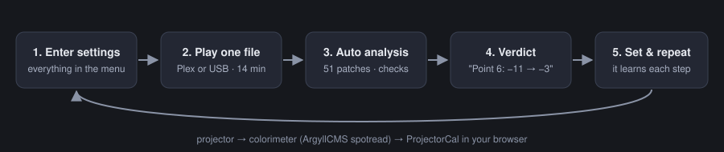

# ProjectorCal

**Step-by-step, measurement-based calibration of Vidda (Hisense) laser projectors for accurate movie color.**

ProjectorCal drives a colorimeter through [ArgyllCMS](https://www.argyllcms.com/) `spotread`, plays calibration
patches through your normal video chain (Plex, or a USB stick in the projector's own media player) and tells you
**exactly which menu values to set** — white balance Gain/Offset, the 20 gamma control points and the CMS — then
learns from every run how your projector reacts and refines the next suggestion.

It runs locally in your browser, works offline, has no accounts and no telemetry.

> Developed and verified on a **Vidda C3S** with a **Calibrite Display Plus HL**. Other Vidda / Hisense laser
> projectors with the same Expert menu (20-point gamma, 2-point white balance, 6-color CMS) should work; see
> [Other projectors and meters](#other-projectors-and-meters).



## What you get

* **Full automatic check.** Start the run, play one video file (SDR ≈ 14 min, HDR10 ≈ 6.5 min) and leave the room.
  The program syncs to a start mark, assigns every reading to its patch, rejects anything suspicious (menus on
  screen, someone walking in front of the beam, room light switched on, a paused player) and analyzes 51 patches:
  gray scale 0–100 % in 5 % steps, the six primaries/secondaries and 24 saturation sweeps.
* **A verdict with concrete numbers.** "Set Point 6: −11 → −3, Offset R: 0 → −1, Blue Bright: 4 → 5" — not just
  "gamma is off". You enter all current projector settings before the run, the program stores a snapshot and computes
  the changes from there.
* **It learns your projector.** Each run is compared with the previous one; the program measures how much one step
  of each control really moves the picture (Gain, Offset, every gamma point, CMS Bright/Saturation) and uses that
  for the next plan.
* **Movie-oriented color targets.** CMS suggestions minimize the ΔE2000 of *all* saturations of a hue, with mid
  saturations (25–75 %) weighted twice as much as 100 % — in films, skin, sky, foliage and interiors are almost never
  fully saturated.
* **Robust to real life.** Laser warm-up drift is detected and corrected, the meter's real reading time is modeled
  (up to 7 s per reading on dark patches), the player may stutter, and raw readings are stored so any run can be
  re-analyzed by a newer version.
* **A guided manual wizard** as well: black level and contrast (PLUGE/clipping), laser level, gray scale with live
  RGB bars, gamma by points, CMS, SDR verification, HDR10, Dolby Vision checklist.
* **Report** for print/PDF named after the actual run date, CSV/JSON export of all readings.

## Requirements

| | |
|---|---|
| Computer | macOS (packaged app). Linux works from source. Python 3.8+ (standard library only). |
| Meter | A colorimeter supported by ArgyllCMS. Tested: Calibrite Display Plus HL (i1Display Pro family). |
| Software | ArgyllCMS (`brew install argyll-cms` on macOS, `apt install argyll` on Debian/Ubuntu). |
| Player | Anything that plays 4K HEVC 10-bit files: a Plex client, or the projector's own media player (USB stick). |
| Room | Dark. Calibrate at night or with blackout curtains. |

> **Calibrite Display Plus HL:** run Calibrite PROFILER once with the meter before using it with ArgyllCMS
> (it unlocks the HL for third-party software).

## Install

### macOS app

1. Install ArgyllCMS: `brew install argyll-cms` (install [Homebrew](https://brew.sh) first if needed).
2. Download `ProjectorCal-macOS.zip` from [Releases](../../releases), unzip and move `ProjectorCal.app` to
   Applications. The app is not signed: right-click → **Open** the first time.
3. Download `ProjectorCal-patches-v3.zip` (≈ 0.9 GB) from the same release — these are the video patches.

### From source (macOS / Linux)

```bash
git clone https://github.com/khursevich/ProjectorCal.git
cd ProjectorCal
unzip ProjectorCal-patches-v3.zip -d assets/   # the video patches → assets/patches/
python3 -m projectorcal            # opens the UI in your browser
python3 -m projectorcal --mock     # try it without a meter (simulated projector)
```

Build the app yourself: `python3 tools/build_app.py` (add `--no-patches` for a small app without the videos).

## Getting the patches onto the projector

The patches are still frames lasting 10 minutes each, 3840×2160, 24p, HEVC Main 10, limited range.
SDR is Rec.709; HDR10 is PQ / BT.2020 with mastering metadata (P3-D65, 1000 nits).

**Plex.** Copy the patch folder to your Plex server, add a library of type **Other Videos** pointing to it and scan.
Play the files from your Plex client (streaming box, TV app).

**USB stick.** Copy the folder to an exFAT-formatted stick, plug it into the projector and open the files in its
built-in media player. If possible, use the same player you watch movies on: the calibration is only valid for
the signal path you measured.

Either way, make sure the player does **not** alter the picture (no "enhance", no HDR conversion of SDR, output as
for movies) and that the projector is in the picture mode you want to calibrate (e.g. **Filmmaker**).

| Files | Content |
|---|---|
| `SDR_01…21` | gray 100 % → 0 % in 5 % steps |
| `SDR_22…27` | red, yellow, green, cyan, blue, magenta at 100 % |
| `SDR_28…51` | the six hues at 25/50/75/100 % saturation (75 % amplitude) |
| `SDR_52`, `SDR_53` | PLUGE (black level) and white clipping (contrast) |
| `HDR_01…21` | HDR10 PQ gray 100 % → 0 % |
| `AUTO/ProjectorCal_AUTO_SDR_v3.mp4` | the full automatic SDR check |
| `AUTO/ProjectorCal_AUTO_HDR10_v3.mp4` | the full automatic HDR10 check |

## Setting up the meter

* Warm the projector up for **45–60 minutes** (the laser brightness drifts up to 5 % in the first minutes; the
  program corrects for it, but a warm projector is better).
* Mount the meter facing the center of the screen, 0.7–1.5 m away, **below the beam** so its shadow falls on the
  bottom edge of the picture. Use the built-in stand or a tripod. Do not move it during a session.
* Lights off. Close the projector menu before every reading — an open menu reaches the meter.
* Turn off everything "dynamic": Dynamic Contrast, AI picture features, MEMC, light sensor / eye care.

## Workflow

1. **Preparation.** The program finds `spotread` and the meter and takes a test reading. Measure the room light
   with the lens covered.
2. **Enter your current projector settings** in the *Full check* screen: picture mode, laser level, Black Level,
   Contrast, Color Temp, Gain/Offset R G B, gamma preset and all 20 gamma points, CMS (tone/saturation/brightness of
   7 colors), processing options, HDR settings — plus up to six free "name = value" fields for anything else.
3. **Start the full check** and play `AUTO/ProjectorCal_AUTO_SDR_v3.mp4`. Play may be pressed before or after Start.
   Do not touch the remote until it finishes.
4. **Read the verdict.** It lists every value to change with "now → set to", and the reasons. Set the values in the
   projector menu, press *"I set all this in the menu → save to settings"* and run the check again.
5. Repeat until the verdict says everything is within tolerance (usually 3–6 runs). Changing several independent
   groups in one run is fine (e.g. Gain + gamma points, or several CMS colors); the program still learns each.
6. Optional: the manual wizard steps for black level/contrast by eye, HDR10, Dolby Vision; the **report** for print.

What "good" looks like (from a real Vidda C3S): gray ΔE2000 ≈ 1, gamma 2.40 ± 0.02 on every step from 10 % to 95 %,
average color ΔE ≈ 1.7 over all 30 color patches, contrast ≈ 1350:1. See the
[case study](docs/case-study/vidda-c3s.md).

## Things worth knowing about the Vidda C3S

These were measured and are built into the program (details in the [case study](docs/case-study/vidda-c3s.md)):

* **Gamma → Adjust → Control Point has 20 points; point k controls the 5·k % step** (1 → 5 %, 10 → 50 %, 20 → 100 %).
  One step of Gain moves that step's luminance by ≈ 2.2 %.
* **Offset is very coarse**: one step of Offset R changes red by ≈ 5 % at white and ≈ 25 % at 20 % gray. There is no
  in-between; the program solves Gain and Offset together and never "fixes" bright steps with Offset.
* **CMS Bright is ≈ 10–12 % luminance per step** and acts on the whole hue (≈ ¼ of that at 25 % saturation, fully from
  75 %). Mid saturations and 100 % often pull in opposite directions; the program finds the best compromise.
* **The white balance "breathes" by 2–3 % between sessions** even with no changes — the program does not chase
  differences that small unless it has learned the exact step size.
* Intermediate saturations are undersaturated by 5–10 % even when 100 % colors are accurate: try **Color Space
  BT.709** instead of Auto.

## Other projectors and meters

* **Other Vidda / Hisense models.** The menu layout is usually the same, but step sizes may differ — the program learns
  them from your runs. If your gamma has a different number of points, use *Gamma by points → point probe* to map them.
* **Other meters.** Any ArgyllCMS-supported colorimeter or spectrometer should work. The automatic run's segment
  lengths are tuned to the reading time of i1Display-family meters with a 25 % margin; a much slower meter may lose
  some dark patches (they are flagged, never silently wrong).
* **Accuracy.** A colorimeter without a spectral correction for RGB-laser light can be off by a few hundred kelvin in
  absolute white point and on saturated colors. Gray-scale tracking, gamma and changes between runs are reliable.
  If you have a `.ccss`/`.ccmx` for your meter and a laser display, set it in *Settings → Correction*.

## Privacy

Everything stays on your computer: sessions are JSON files in `~/Library/Application Support/ProjectorCal`
(macOS) or `~/.local/share/ProjectorCal` (Linux). The UI server listens on 127.0.0.1 only.

## Documentation

* [How it works](docs/HOW_IT_WORKS.md) — formulas, tolerances, the auto-run analyzer, the projector models.
* [Case study: Vidda C3S](docs/case-study/vidda-c3s.md) — seven full runs from the first attempt to the final settings.
* [Development](docs/DEVELOPMENT.md) — architecture, tests, building the app, regenerating the patches.

## License

MIT — see [LICENSE](LICENSE). ArgyllCMS is a separate program by Graeme W. Gill (AGPL), used as an external tool.
Vidda and Hisense are trademarks of their owners; this project is not affiliated with them.
