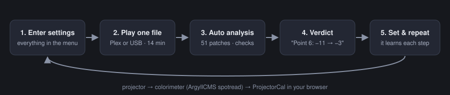

# Calibrate your Vidda / Hisense projector yourself

**ProjectorCal** is a free, open-source program that measures your projector with a colorimeter and tells you
**exactly which menu values to set** — white balance Gain/Offset, gamma control points and CMS. Play one video from
a USB stick or Plex, leave the room, read the verdict, set the values, repeat. Usually 3–6 runs.

* **Projectors:** Vidda C3S (verified), C3 / C3 Pro / C3 Ultra, Hisense C2 / C2 Pro / C2 Ultra, C1, PX1 / PX2 / PX3,
  Hisense laser TVs, any display with a Gain/Offset white balance and CMS.
* **Meters:** any [ArgyllCMS](https://www.argyllcms.com/doc/instruments.html) instrument — i1Display Pro,
  Calibrite Display Plus HL / ColorChecker Display, ColorMunki Display, SpyderX / Spyder5, i1Pro, Klein K10.
* **Computer:** Windows 10/11 (beta), macOS or Linux. Runs locally in your browser, offline, no account.

**[Download the latest release](https://github.com/khursevich/ProjectorCal/releases/latest)** ·
[Source code on GitHub](https://github.com/khursevich/ProjectorCal)

## Start here

* [Beginner's guide — step by step](GUIDE.md)
* [Supported projectors and meters](SUPPORTED.md)
* [FAQ and troubleshooting](FAQ.md)
* [Case study: Vidda C3S from factory Filmmaker to gray ΔE ≈ 1](case-study/vidda-c3s.md)
* [How it works (formulas, tolerances, algorithms)](HOW_IT_WORKS.md)

## What a result looks like

On a Vidda C3S with a Calibrite Display Plus HL: gray ΔE2000 ≈ 1.0, gamma 2.40 ± 0.02 on every step from 10 % to
95 %, weighted color ΔE ≈ 1.7, contrast ≈ 1350:1 — in seven runs from the factory Filmmaker mode.

## Why this works on any model

ProjectorCal doesn't rely on a database of "best settings" copied from another unit. It measures *your*
projector, suggests a change, measures again and learns how far one step of each control really moves the picture.
Every unit and firmware is different; the measurement is what counts.

---

Русский: [краткое руководство на русском](https://github.com/khursevich/ProjectorCal/blob/main/README.ru.md).
